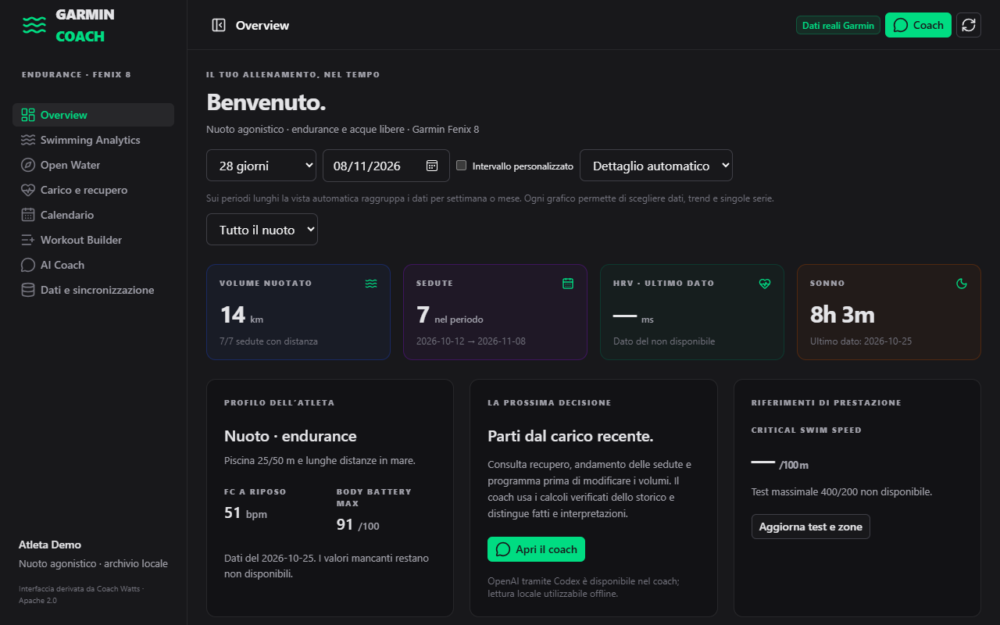
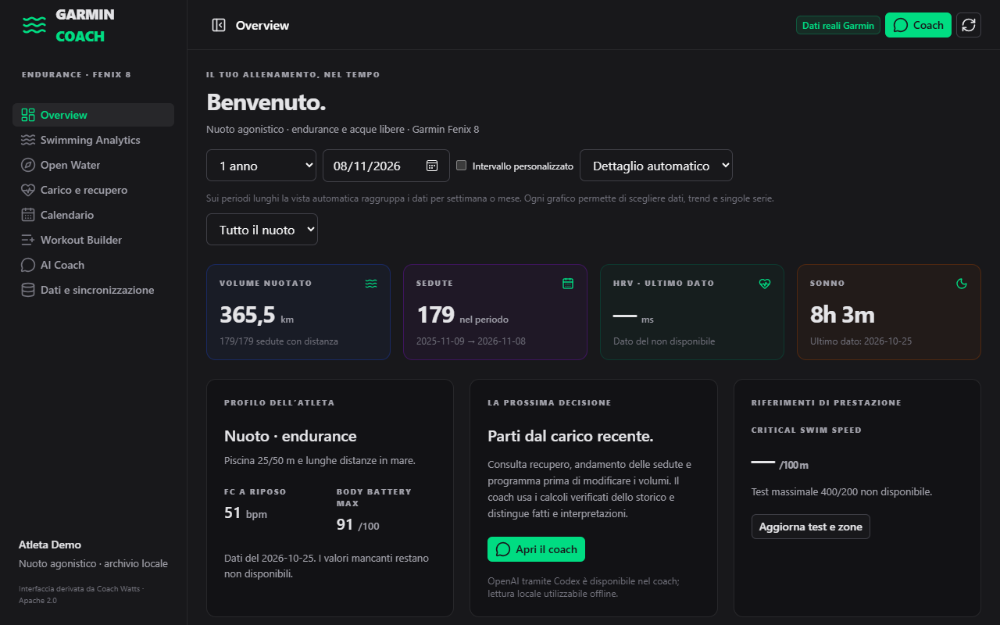
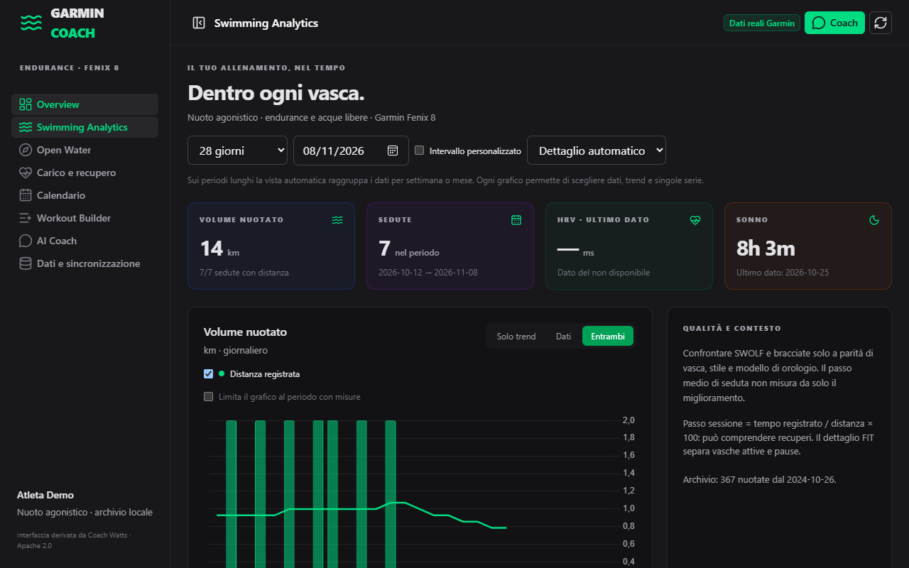
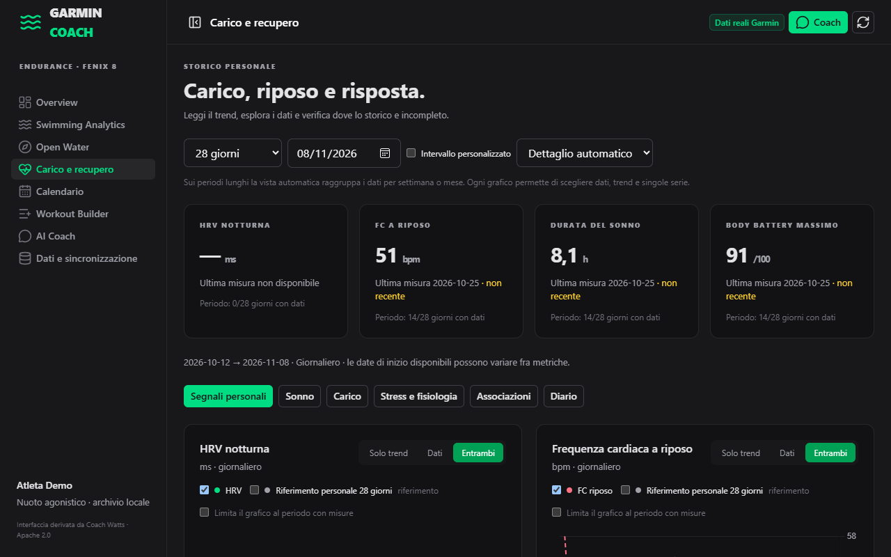
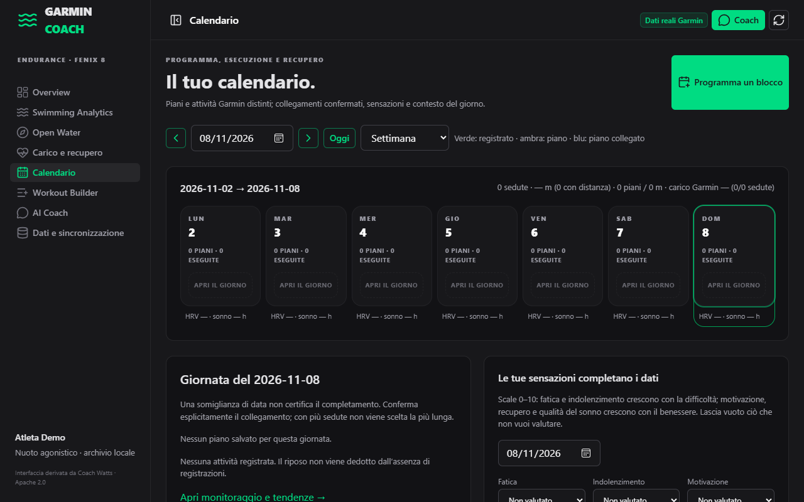
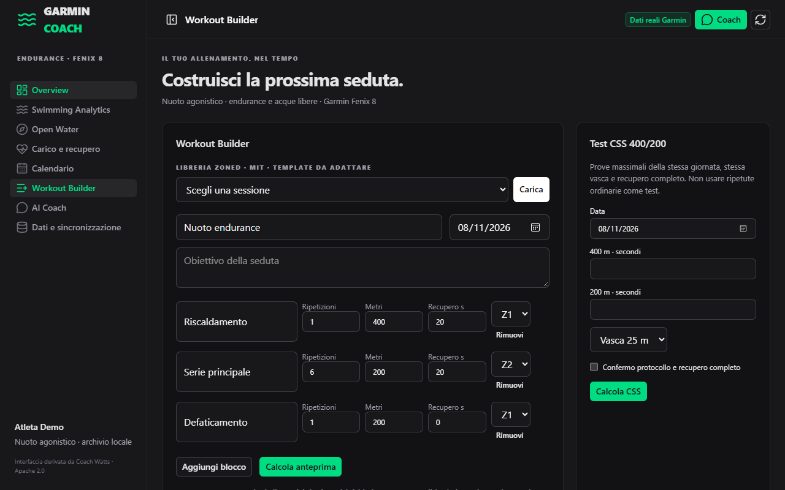

# Swim Garmin Coach

**A swim coach that runs on your own computer.** It reads the data from your Garmin watch and answers two questions:
*how am I doing?* and *what has changed?* It never invents a number: every figure comes from a tested function, and when
the data is not enough it says so.



> All data shown here is **synthetic** (generated by `scripts/make_demo_data.py`). No real athlete data is in this repository.
> Code, comments and in-app texts are in Italian; this README is in English.

## Contents

1. [Why this exists](#why-this-exists)
2. [What you can see](#what-you-can-see)
3. [How it works](#how-it-works)
4. [Design rules](#design-rules)
5. [Quick start](#quick-start)
6. [Using your own data](#using-your-own-data)
7. [How it was built](#how-it-was-built)
8. [Limits and roadmap](#limits-and-roadmap)
9. [Credits and license](#credits-and-license)

## Why this exists

Watch apps show many numbers and few answers, and most analysis tools are built for running and cycling. Swimming has its own
problems: a pool length changes what SWOLF means, a new watch model changes what can be recorded, open-water distance is only
an estimate, and heart rate in water is unreliable. This project keeps those differences visible instead of hiding them.

It started from a rule: **calculation is deterministic, judgment is optional.** The numbers are computed by Python; an AI coach
can be switched on to interpret them, but it only receives an analytic package and its answers are validated against it.

## What you can see

| | |
|---|---|
|  **Volume.** Weekly totals as bars with a trend line. A week without swims is **0 km** when the watch was in use; a grey band marks periods with **no data at all**. |  **Swimming analytics.** Repeats compared by distance, stroke and pool length; SWOLF and pace per watch model; session-by-session medians. |
|  **Load and recovery.** Sleep, HRV, resting heart rate with personal baselines and explicit gaps. |  **Calendar.** Planned vs done, 1-4 week proposals, confirmations before anything is saved. |



**Workout builder** with swim blocks and zones, and a critical swim speed (CSS) test from 400 m and 200 m efforts.

## How it works

```
Garmin export / FIT files / personal API
              │  ingest (src/garmin_coach/ingest)
              ▼
     DuckDB archive  ── activities, laps, pool lengths, sleep, HRV, races
              │  analysis (src/garmin_coach/analysis, metrics)
              ▼
     JSON contract  ── one API (Starlette) shared by the app and local tools
              │
              ▼
     Nuxt interface (frontend)   +   optional AI coach (validated)
```

- **Ingest**: parses FIT files (laps, pool lengths, strokes), health and sleep summaries; keeps originals untouched and deduplicates by ID.
- **Archive**: a single DuckDB file. Facts live in the database; plans, goals and notes live in readable Markdown (`coach/`).
- **Analysis**: pure functions with tests. Each returns the value *and* its coverage (how many sessions, how many days).
- **Interface**: Nuxt + Nuxt UI + Chart.js, served by the same Python process.
- **Coach (optional)**: receives volumes, paces, HRV, sleep and goals; never raw files or GPS. A schema and a validator reject invented numbers.

## Design rules

1. **Missing is not zero.** A zero and "no data" never look alike. Every chart says which one it is.
2. **Refuse rather than footnote.** SWOLF across different pool lengths, strokes or watch models is not compared.
3. **Every number carries its basis**: period, number of sessions, coverage.
4. **Weak science stays descriptive.** Acute/chronic load ratio is context, not an injury predictor; HRV is a hint, not an order.
5. **The athlete decides.** Plans, corrections and notes are saved only after a preview and an explicit confirmation.

The complete list is in `REGOLE.md`.

## Quick start

Requirements: Python 3.12 and Node 20+ (Windows-first; the Python part is portable).

```bash
python -m venv .venv
.venv\Scripts\pip install -e .
python scripts/make_demo_data.py          # synthetic archive in data/
cd frontend && npm ci && npm run build && cd ..
python -m uvicorn garmin_coach.app.server:app --port 8766
```

Open <http://127.0.0.1:8766/>. Run the tests with `python -m pytest tests`.

## Using your own data

- Put your Garmin export in `garmin-export/` or use the optional Garmin personal API. Both folders are ignored by git.
- Write your profile, goals and races in `coach/` (templates in `coach/LEGGIMI.md`).
- Declare the watch models you used in `coach/orologi.md`: the app shows the **model** (e.g. Fenix 6X, Fenix 7), not the single unit.
- A trainer can run a separate copy with their own data. Nothing leaves the computer unless you enable the AI coach.

## How it was built

The project grew in stages, each driven by real use:

1. **Data foundation**: import of nine seasons of watch and race data, with a data dictionary and integrity checks.
2. **Honest analysis**: volume, paces, SWOLF, critical swim speed, open-water pace with GPS checks, planned-vs-done.
3. **Interface**: derived from Coach Watts, adapted to swimming; calendar, monitoring, session explorer, workout builder.
4. **Coach**: a constrained AI assistant with a validator.
5. **Readability pass**: charts redesigned (bars, true zeros, grey "no data" bands, markers on isolated points) and watch details
   reduced to the model.
6. **Research**: a review of open-source endurance projects and of the swimming literature guided the roadmap (see below).

The suite has over 1,100 tests covering ingestion, analysis contracts and the interface.

## Limits and roadmap

- No workouts are sent to the watch (the personal API does not allow writing).
- Intensity data (heart rate, load) exists only for recent years; older sessions have volume only.
- Planned: profiles per athlete and FIT upload from the interface, a personal race-distance model, heart-rate-based load, intensity
  distribution, a stroke rate/length profile, and a "report for the coach". Language switch (Italian/English) is also planned.

## Credits and license

MIT. The interface derives from [Coach Watts](https://github.com/newpush/coach) (Apache-2.0); other reused components
(Garmin-Grafana, Garmin Health Dashboard, Zoned) are listed in `licenses/`. Not affiliated with Garmin.
